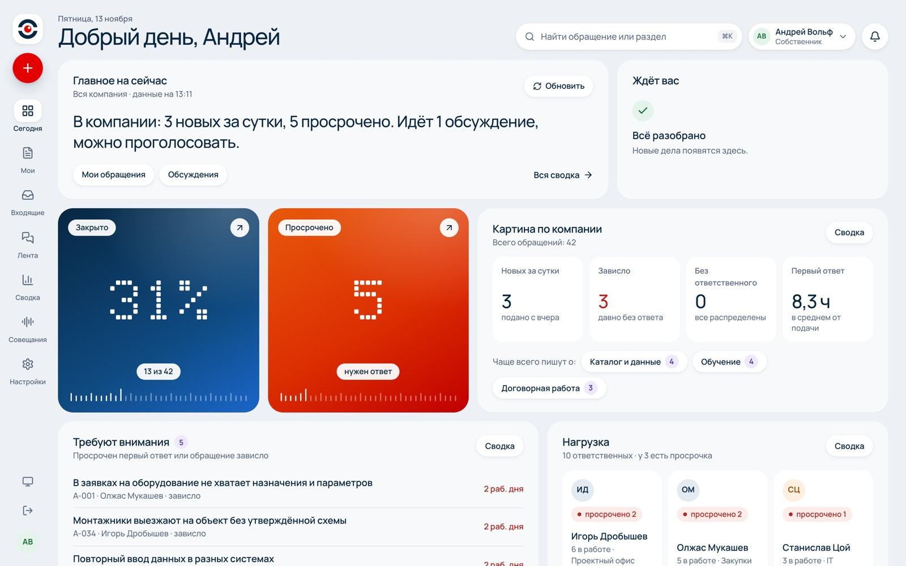
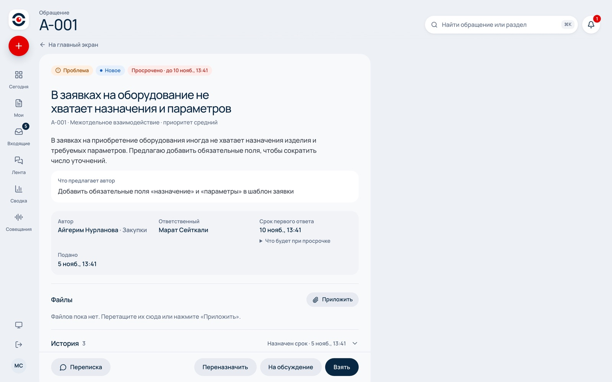
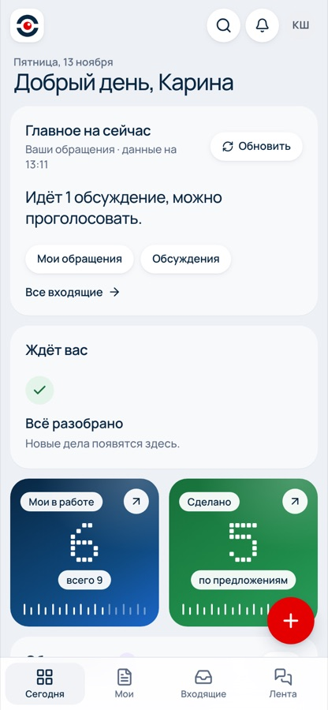
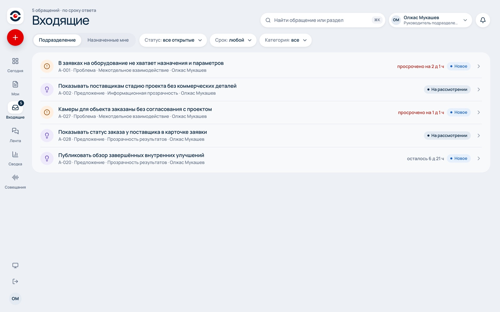
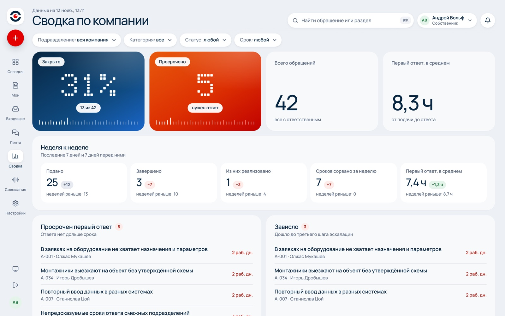

<p align="center">
  
</p>

<h1 align="center">Обращения и предложения сотрудников</h1>

<p align="center">
  <b>У каждого обращения есть ответственный и срок ответа.</b><br>
  Система для ГК «Модус Трейд»: проблемы, идеи и благодарности попадают в одно место, а не теряются в мессенджерах и на совещаниях.
</p>

<p align="center">
  <a href="https://modus.systm.kz">modus.systm.kz</a> ·
  <a href="https://t.me/modus_fb_bot">@modus_fb_bot</a> ·
  <a href="SPEC.md">Спецификация</a> ·
  <a href="contract/openapi.yaml">Контракт API</a>
</p>

---

## Зачем

Предложения сотрудников звучат в WhatsApp, на планёрках и в коридоре. Собственник не видит общей картины, сотрудник не знает, что стало с его идеей, руководитель обсуждает одну и ту же проблему в третий раз. Когда предложения не доходят до решения, люди перестают их высказывать.

Система собирает всё в одну очередь: у каждого обращения есть номер, ответственный, срок и итог, который видит автор.

## Как это работает

1. **Сотрудник пишет боту**: текстом, голосовым или пересылкой из рабочего чата. Через несколько секунд приходит оформленный черновик. Сотрудник подтверждает его и дальше видит статус, ответственного и срок.
2. **Обращение попадает к ответственному** по правилу категории. Система подсказывает похожие обращения, повторы склеиваются в одно.
3. **Не ответили в срок** — обращение уходит руководителю, затем собственнику.
4. **Спорное предложение выносится на обсуждение**: команда голосует и комментирует.
5. **Решение превращается в задачу в Битрикс24**, а реализованное попадает в общую ленту.
6. **Запись совещания** становится черновиками обращений с цитатами из разговора.
7. **Собственник каждое утро получает сводку**: что нового, что зависло, что закрыто и о чём пишут чаще всего.

<p align="center">
  
</p>

## Для каждой роли

| | Что видит и делает |
|---|---|
| **Сотрудник** | Подаёт обращения в боте, на сайте или в приложении. Следит за своими, отвечает на уточнения, голосует в обсуждениях. |
| **Ответственный** | Разбирает назначенные обращения: отвечает, запрашивает уточнения, склеивает повторы, фиксирует решение, создаёт задачу в Битрикс24. |
| **Руководитель** | Видит всё по своему подразделению, переназначает, выносит на обсуждение, загружает записи совещаний, получает сводку по отделу. |
| **Собственник** | Видит всю компанию: сводку, просрочки, нагрузку на ответственных, частые темы. Просроченное доходит до него само. |
| **Администратор** | Люди, подразделения, категории и сроки ответа, заявки на доступ и приглашения. |

«Ответственный» — не роль, а назначение: им может быть любой сотрудник, закреплённый за категорией или конкретным обращением.

<table>
  <tr>
    <td width="62%"></td>
    <td width="38%" align="center"></td>
  </tr>
  <tr>
    <td>Карточка обращения: срок, ответственный, история и действия в одном месте.</td>
    <td align="center">То же самое на телефоне и в Telegram Mini App.</td>
  </tr>
  <tr>
    <td></td>
    <td></td>
  </tr>
  <tr>
    <td>Входящие руководителя по сроку ответа.</td>
    <td>Сводка по компании.</td>
  </tr>
</table>

## Где работает

- **Telegram-бот** — быстрая подача текстом и голосом, уведомления, утренняя сводка, коды входа.
- **Telegram Mini App** — все экраны роли прямо в Telegram.
- **Веб** — [modus.systm.kz](https://modus.systm.kz), вход по почте, через Telegram или Битрикс24. Экран обновляется сам: новые обращения и ответы приходят без перезагрузки.
- **Мобильное приложение** — Flutter, Android и iOS.

## Устройство

Вся бизнес-логика живёт в бэкенде: права, маршрутизация, сроки, склейка повторов и эскалация. Клиенты показывают данные и отправляют действия через один HTTP API, описанный в [OpenAPI](contract/openapi.yaml).

| Модуль | Технологии | Папка |
|---|---|---|
| Бэкенд | FastAPI, PostgreSQL, фоновые задачи | [`backend/`](backend/README.md) |
| Веб и Mini App | React, TypeScript, Vite | [`web/`](web/README.md) |
| Мобильное приложение | Flutter | [`flutter/`](flutter/README.md) |
| Бот | aiogram 3 | [`bot/`](bot/README.md) |
| Разбор текста | Claude API: черновик, поиск повторов, разбор совещаний, текст сводки | `backend/` |
| Распознавание речи | ElevenLabs Scribe | `backend/` |
| Интеграция | Битрикс24: задачи и вход через портал | `backend/` |
| Размещение | Docker Compose на VPS, HTTPS | [`deploy/`](deploy/) |

Внешние сервисы подключены через адаптеры, поэтому в тестах их легко подменить.

## Исходные материалы

ТЗ организаторов, демонстрационный датасет и расшифровка открытия хакатона — в [`docs/sources/`](docs/sources/). Решения команды по ним собраны в [SPEC.md](SPEC.md).

## Запуск локально

Каждый модуль запускается отдельно, подробности — в его README.

```bash
cd backend && uv sync && uv run python scripts/dev.py   # API на http://127.0.0.1:8000, документация /api/v1/docs
```

```bash
cd web && npm install && npm run dev                      # веб на http://localhost:5173
```

```bash
cd bot && uv sync && uv run python -m app                 # нужен .env по образцу .env.example
```

```bash
cd flutter && flutter run --dart-define=API_BASE_URL=http://127.0.0.1:8000
```

## Команда

Сделано на хакатоне ГК «Модус Трейд», 10–13 ноября 2026. Финал — Demo Day 16 ноября.

- **Александр** ([@Blckk699](https://github.com/Blckk699)) — продукт, оркестрация, Flutter, Telegram
- **Николай** ([@N1kollo](https://github.com/N1kollo)) — бэкенд
- **[@klinduhwtf](https://github.com/klinduhwtf)** — веб и экраны Mini App

Код писала команда ИИ-агентов, по агенту на модуль: они брали тикеты, открывали PR и проходили ревью. Люди задавали направление, принимали решения и выкладывали на сервер. Правила работы агентов — в [CLAUDE.md](CLAUDE.md).
