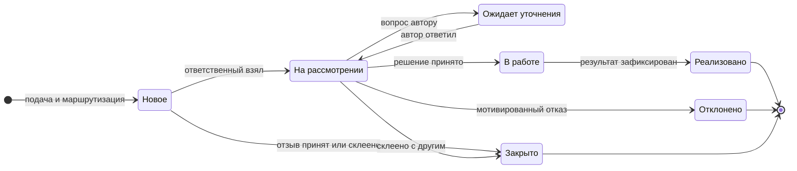

_Хакатон ГК «Модус Трейд» · спека по шаблону to-spec · 10 ноября 2026_

# Система обращений и предложений сотрудников

Спека собрана из решений команды, ТЗ организаторов, демонстрационного датасета и записи открытия хакатона. Кодовой базы ещё нет, поэтому все решения описывают новый проект.

- **Сдача:** пятница, 13 ноября, 14:00
- **Финал:** 16 ноября, Demo Day
- **Формат:** работающий MVP без заглушек
- **Клиенты:** Telegram, Flutter, веб

## Problem Statement

_Проблема глазами пользователей_

**Собственник компании** не видит, какие вопросы требуют решения. Проблемы и предложения сотрудников приходят в WhatsApp, звучат на совещаниях и в телефонных разговорах. Чтобы собрать картину, ему приходится вспоминать каждую встречу и переписку.

**Сотрудник** сообщает о проблеме и не знает, что с ней происходит. Он считает, что вопрос решается, а тот потерялся среди срочных дел. Спросить о судьбе обращения можно только лично.

**Руководитель подразделения** получает обращения из разных каналов без единого списка, сроков и истории. Одна и та же проблема приходит от разных людей и каждый раз обсуждается заново.

Общее следствие, которое собственник назвал главным риском: когда предложения не находят решения, команда перестаёт их высказывать.

## Solution

_Решение глазами пользователей_

Единая система обращений, в которую попадает всё: проблемы, предложения и положительные отзывы.

- **Сотрудник** пишет боту в Telegram, наговаривает голосовое или пересылает сообщение из рабочего чата. Через несколько секунд он получает оформленный черновик, подтверждает его и дальше видит статус, ответственного, срок и итог.
- **Ответственный** получает обращение по правилу категории, отвечает, запрашивает уточнения, фиксирует решение. Система подсказывает похожие обращения и напоминает о сроке.
- **Руководитель** видит обращения своего подразделения, выносит важные на общее обсуждение с голосованием и превращает запись совещания в черновики обращений.
- **Собственник** каждое утро получает сводку: что нового, что зависло, что закрыто, какие темы повторяются. Просроченные обращения доходят до него сами.
- **Вся команда** видит ленту реализованных улучшений: что предложили и что в итоге сделали.

Каждый клиент (Mini App в Telegram, мобильное приложение, веб) даёт пользователю всё, что доступно его роли.

## User Stories

_70 историй, сквозная нумерация_

#### Сотрудник

1. Как сотрудник, я хочу написать боту обычным текстом, чтобы подать обращение за минуту, не открывая отдельную систему.
2. Как сотрудник, я хочу наговорить боту голосовое сообщение, чтобы подать обращение на ходу.
3. Как сотрудник, я хочу переслать боту сообщение из рабочего чата, чтобы не перепечатывать уже сформулированную проблему.
4. Как сотрудник, я хочу получить готовый черновик с типом, категорией, приоритетом и краткой сутью, чтобы не разбираться в классификации самому.
5. Как сотрудник, я хочу поправить любое поле черновика перед отправкой, чтобы ошибка распознавания не увела обращение не тому человеку.
6. Как сотрудник, я хочу подать обращение через обычную форму, чтобы заполнить всё самому, когда мне так удобнее.
7. Как сотрудник, я хочу приложить файлы к обращению, чтобы показать проблему на примере.
8. Как сотрудник, я хочу указать предлагаемое решение, чтобы ответственный видел не только проблему, но и мой вариант.
9. Как сотрудник, я хочу сразу после подачи увидеть номер обращения, ответственного и срок первого ответа, чтобы понимать, чего и когда ждать.
10. Как сотрудник, я хочу видеть список своих обращений со статусами, чтобы не спрашивать об их судьбе лично.
11. Как сотрудник, я хочу видеть историю событий по обращению, чтобы понимать, что с ним происходило.
12. Как сотрудник, я хочу получать уведомление в Telegram при каждой смене статуса, чтобы узнавать о движении без захода в систему.
13. Как сотрудник, я хочу ответить на уточняющий вопрос прямо в боте, чтобы не тратить время на переход в приложение.
14. Как сотрудник, я хочу прочитать причину отказа, чтобы понимать, почему моё предложение не принято.
15. Как сотрудник, я хочу прочитать зафиксированный результат, чтобы видеть, что именно сделано по моему обращению.
16. Как сотрудник, я хочу оставить положительный отзыв, чтобы отметить то, что в компании работает хорошо.
17. Как сотрудник, я хочу, чтобы моё обращение по умолчанию видели только те, кто его рассматривает, чтобы спокойно писать о проблемах со смежными отделами.
18. Как сотрудник, я хочу сам решить, показывать ли моё имя при выносе обращения на общее обсуждение, чтобы контролировать свою публичность.
19. Как сотрудник, я хочу получать статусы основного обращения, если моё присоединили к нему как повтор, чтобы не остаться без ответа.
20. Как сотрудник, я хочу видеть ленту реализованных улучшений, чтобы знать, что предложения доходят до результата.
21. Как сотрудник, я хочу проголосовать «за» или «против» вынесенного на обсуждение обращения, чтобы моё мнение учли при решении.
22. Как сотрудник, я хочу прокомментировать вынесенное обращение, чтобы дополнить его своим опытом.
23. Как сотрудник, я хочу входить через Telegram без отдельного пароля, чтобы не заводить ещё одну учётную запись.
24. Как сотрудник, я хочу иметь одинаковые возможности в Mini App, мобильном приложении и вебе, чтобы пользоваться тем, что под рукой.

#### Ответственный

25. Как ответственный, я хочу получать уведомление о новом назначенном обращении, чтобы не проверять очередь вручную.
26. Как ответственный, я хочу видеть очередь назначенных обращений, отсортированную по сроку, чтобы начинать с самого срочного.
27. Как ответственный, я хочу видеть, сколько времени осталось до срока первого ответа, чтобы не допустить просрочки.
28. Как ответственный, я хочу взять обращение на рассмотрение, чтобы автор видел, что им занимаются.
29. Как ответственный, я хочу задать автору уточняющий вопрос, чтобы получить недостающие сведения, не теряя время своего срока.
30. Как ответственный, я хочу перевести обращение в работу с записью принятого решения, чтобы зафиксировать, что будет сделано.
31. Как ответственный, я хочу отклонить обращение с обязательным объяснением, чтобы автор получил мотивированный ответ.
32. Как ответственный, я хочу зафиксировать результат и отметить обращение реализованным, чтобы решение сохранилось в истории.
33. Как ответственный, я хочу принять положительный отзыв одним действием, чтобы не вести его через весь цикл.
34. Как ответственный, я хочу видеть подсказку о похожем обращении с объяснением сходства, чтобы не решать одну проблему дважды.
35. Как ответственный, я хочу присоединить повтор к основному обращению одной кнопкой, чтобы вести одну карточку вместо нескольких.
36. Как ответственный, я хочу отметить подсказку как «это другое», чтобы ложное совпадение не мешало работе.
37. Как ответственный, я хочу видеть, сколько человек сообщили о той же проблеме, чтобы оценить её масштаб.
38. Как ответственный, я хочу вынести обращение на общее обсуждение со своей формулировкой и сроком, чтобы узнать мнение команды.
39. Как ответственный, я хочу создать задачу в Битрикс24 из обращения и видеть ссылку на неё, чтобы работа продолжилась в привычной системе.
40. Как ответственный, я хочу получить напоминание, когда срок истёк, чтобы успеть ответить до эскалации.
41. Как ответственный, я хочу обрабатывать обращения с телефона, чтобы отвечать вне рабочего места.

#### Руководитель подразделения

42. Как руководитель, я хочу видеть все обращения своего подразделения, чтобы понимать, с чем к нам приходят.
43. Как руководитель, я хочу фильтровать обращения по категории, статусу и сроку, чтобы быстро находить просроченные.
44. Как руководитель, я хочу переназначить ответственного с указанием причины, чтобы обращение попало к тому, кто может его решить.
45. Как руководитель, я хочу получить уведомление, если ответственный не ответил в срок, чтобы вмешаться вовремя.
46. Как руководитель, я хочу принять решение по любому обращению своего подразделения, чтобы не ждать ответственного в спорных случаях.
47. Как руководитель, я хочу видеть счёт голосов и комментарии и зафиксировать итог обсуждения, чтобы решение опиралось на мнение команды.
48. Как руководитель, я хочу загрузить аудиозапись совещания, чтобы сказанное на встрече не потерялось.
49. Как руководитель, я хочу получить из записи черновики обращений с цитатами из расшифровки, чтобы проверить, что система поняла сказанное верно.
50. Как руководитель, я хочу подтвердить, поправить или отбросить каждый черновик, чтобы в систему попало только то, что действительно обсуждалось.
51. Как руководитель, я хочу указать сотрудника как автора черновика, чтобы он получал статусы по своему вопросу.
52. Как руководитель, я хочу получать утреннюю сводку по подразделению в Telegram, чтобы начинать день с понимания очереди.
53. Как руководитель, я хочу видеть экран сводки по подразделению, чтобы оценивать нагрузку и скорость ответа.

#### Собственник

54. Как собственник, я хочу получать утреннюю сводку в Telegram с новым, зависшим, закрытым и повторяющимся, чтобы видеть картину, не заходя в систему.
55. Как собственник, я хочу запросить сводку командой в любой момент, чтобы подготовиться к встрече.
56. Как собственник, я хочу видеть по компании количество обращений по типам и категориям, долю закрытых и среднее время первого ответа, чтобы оценивать, работает ли процесс.
57. Как собственник, я хочу видеть список зависших обращений и тех, у кого они зависли, чтобы знать, где нужен мой вопрос.
58. Как собственник, я хочу видеть повторяющиеся проблемы со счётчиком обратившихся, чтобы находить системные сбои.
59. Как собственник, я хочу открыть любое обращение и его историю, чтобы разобраться в деталях.
60. Как собственник, я хочу вмешаться в любое обращение: принять решение или переназначить, чтобы сдвинуть застрявший вопрос.
61. Как собственник, я хочу фильтровать сводку по подразделению, чтобы сравнивать отделы.
62. Как собственник, я хочу загрузить запись совещания, которое я вёл, чтобы поднятые на нём вопросы стали обращениями.
63. Как собственник, я хочу сам подать обращение, чтобы мои замечания шли тем же путём, что и остальные.

#### Администратор

64. Как администратор, я хочу добавить сотрудника по его Telegram, задать роль и подразделение, чтобы он мог войти в систему.
65. Как администратор, я хочу изменить роль и подразделение сотрудника или отключить ему доступ, чтобы права соответствовали реальности.
66. Как администратор, я хочу вести список подразделений и их руководителей, чтобы эскалация шла правильному человеку.
67. Как администратор, я хочу вести категории с ответственным и заместителем, чтобы обращения распределялись без моего участия.
68. Как администратор, я хочу отметить сотрудника отсутствующим, чтобы его обращения получал заместитель.
69. Как администратор, я хочу менять сроки первого ответа по приоритетам, чтобы настраивать процесс без разработчика.
70. Как администратор, я хочу видеть очередь нераспределённых обращений и назначать ответственного вручную, чтобы ни одно обращение не осталось без владельца.
71. Как новый сотрудник, я хочу подать заявку на доступ прямо из бота или с экрана входа, чтобы не искать администратора лично.
72. Как администратор или собственник, я хочу видеть заявки на доступ, назначать роль и подразделение и одобрять или отклонять их, чтобы в систему попадали только свои.
73. Как администратор или собственник, я хочу создать ссылку-приглашение с заранее заданной ролью и подразделением, чтобы сотрудник по ней получил доступ сразу, без ожидания одобрения.
74. Как администратор или собственник, я хочу видеть свои приглашения и отзывать их, чтобы утёкшая ссылка перестала работать.
75. Как новый сотрудник без Telegram, я хочу зарегистрироваться по рабочей почте и паролю, чтобы пользоваться сервисом с рабочего компьютера.
76. Как сотрудник, я хочу привязать Telegram к своему аккаунту, чтобы входить в один клик и получать уведомления бота.
77. Как администратор, я хочу сбросить сотруднику забытый пароль, чтобы он вернул доступ без разработчика.

## Implementation Decisions

_Принятые решения по реализации_

### Архитектура

- Вся бизнес-логика живёт в бэкенде: права, маршрутизация, сроки, склейка, эскалация. Клиенты показывают данные и отправляют действия.
- Контракт API описывается в OpenAPI и фиксируется до начала работы над клиентами. Клиенты стартуют на мок-сервере по этому контракту.
- Мок не хранит состояние: на нём проверяются экраны и правильность запросов, поведение — на реальном сервере в тикетах интеграции.
- Эскалация, обработка записей совещаний и рассылка сводки работают на общем механизме фоновых задач бэкенда.
- Каждый клиент даёт пользователю все функции его роли. Бот остаётся каналом быстрой подачи и уведомлений.
- Внешние сервисы (Claude, ElevenLabs, Telegram, Битрикс24) подключаются через адаптеры, чтобы их можно было подменить в тестах.

| Модуль | Технология | Зона ответственности |
|---|---|---|
| Бэкенд | FastAPI, Postgres | API, права доступа, маршрутизация, фоновые задачи эскалации и сводок |
| Бот | aiogram | Подача текстом, голосом и пересылкой, уведомления, сводка, коды входа |
| Веб и Mini App | React, TypeScript | Общие компоненты, два входа: браузер и Telegram |
| Мобильное приложение | Flutter | Android и iOS |
| Разбор текста | Claude API | Черновик обращения, поиск повторов, извлечение из расшифровки совещания, текст сводки |
| Распознавание речи | ElevenLabs Scribe | Голосовые сообщения и записи совещаний |
| Интеграция | Битрикс24, входящий вебхук | Создание задачи из обращения в тестовом портале команды |
| Размещение | VPS, Docker Compose, домен с HTTPS | Публичный адрес нужен для Mini App и Telegram Login |

### Роли и доступ

- Системных ролей четыре: сотрудник, руководитель подразделения, администратор, собственник.
- «Ответственный» не роль, а назначение: любой пользователь, закреплённый за категорией или конкретным обращением.
- Любой пользователь может быть автором обращения.

| Действие | Сотрудник | Ответственный | Руководитель | Администратор | Собственник |
|---|---|---|---|---|---|
| Создать обращение | да | да | да | да | да |
| Видеть обращения | свои | назначенные | своего подразделения | все | все |
| Приватная переписка по обращению | в своих | да | да | нет | да |
| Менять статус, фиксировать решение | нет | да | да | нет | да |
| Переназначить ответственного | нет | нет | да | да | да |
| Склеить повторы | нет | да | да | нет | да |
| Вынести на общее обсуждение | нет | да | да | нет | да |
| Голосовать и комментировать в обсуждении | да | да | да | да | да |
| Создать задачу в Битрикс24 | нет | да | да | нет | да |
| Загрузить запись совещания | нет | нет | да | нет | да |
| Сводка и аналитика | нет | нет | по подразделению | нет | по компании |
| Настройки: люди, категории, сроки | нет | нет | нет | да | нет |
| Заявки на доступ и приглашения | нет | нет | нет | да | да |

### Видимость и обсуждения

- Все обращения приватны с момента создания.
- Ответственный или руководитель может вынести обращение на общее обсуждение: публичная формулировка, срок, голос «за» или «против», публичные комментарии. Голосование совещательное, итог фиксирует руководитель.
- При выносе автор получает запрос на показ имени. Без согласия в ленте стоит только подразделение.
- Приватная переписка автора с ответственным не публикуется. У обсуждения своя ветка комментариев.
- Обращение в статусе «Реализовано» попадает в общую ленту реализованного с публичной формулировкой результата.
- Анонимной подачи нет.

### Жизненный цикл

- Типов три: проблема, предложение, положительный отзыв. Приоритетов три: высокий, средний, низкий.
- Семь статусов взяты из демонстрационного датасета без изменений.
- Отказ невозможен без текста причины. «Реализовано» невозможно без текста результата.
- Каждое изменение записывается в историю событий обращения.

| Статус | Что означает | Кто переводит |
|---|---|---|
| Новое | Обращение зарегистрировано и назначено, ответственный ещё не открыл | Система |
| На рассмотрении | Ответственный взял обращение и дал первый ответ | Ответственный |
| Ожидает уточнения | Автору задан вопрос, ждём его ответа | Ответственный; обратно — ответ автора |
| В работе | Решение принято, идёт реализация | Ответственный или руководитель |
| Реализовано | Результат зафиксирован текстом | Ответственный |
| Отклонено | Отказ с объяснением причины | Ответственный или руководитель |
| Закрыто | Положительный отзыв принят либо обращение склеено с другим | Ответственный |

### Подача и разбор

- Бот принимает текст, голосовое и пересланное сообщение. Голос расшифровывается, затем Claude предлагает тип, категорию, приоритет, краткую суть и предлагаемое решение.
- Обращение создаётся только после подтверждения автором. Автор может поправить любое поле.
- Форма в клиентах работает без AI-сервисов и остаётся рабочим путём при их недоступности.

### Маршрутизация

- У категории есть ответственный и заместитель. Ответственного назначает правило категории, не модель.
- Если ответственный отмечен отсутствующим, обращение получает заместитель.
- Если нет обоих или категория не определена, обращение попадает в очередь администратора.
- При переназначении срок первого ответа отсчитывается заново, причина записывается в историю.

### Сроки и эскалация

- Срок первого ответа назначается вместе с ответственным при маршрутизации. Он считается в рабочих днях: высокий приоритет — 1, средний — 3, низкий — 5. Значения меняет администратор.
- Рабочие дни — понедельник–пятница, часовой пояс UTC+5. Праздники Казахстана в MVP не учитываются.
- Срок есть только у первого ответа. Уточнение задаётся уже после него, поэтому на срок не влияет.
- Эскалация идёт тремя шагами с интервалом в рабочий день: напоминание ответственному, уведомление руководителю подразделения, блок «Зависло» в сводке собственника.
- Положительные отзывы идут без срока и эскалации.

### Повторы

- Новое обращение сравнивается с открытыми обращениями через Claude, без векторной базы.
- Руководитель и собственник могут выполнить любое действие ответственного по обращению в своей зоне; ответственный при этом не меняется — для смены есть переназначение.
- Подсказки ищутся среди обращений, которые видит пользователь: ответственный — среди назначенных ему, руководитель — в своём подразделении, собственник — по всей компании. Автор не видит чужих обращений при подаче.
- Повтор («Новое» или «На рассмотрении») присоединяется к основному обращению в любом незавершённом статусе — «Новое», «На рассмотрении», «Ожидает уточнения», «В работе», — если пользователь видит оба. Повтор между зонами разных ответственных склеивает руководитель или собственник.
- При склейке повтор переходит в «Закрыто» со ссылкой на основное обращение, его автор становится участником основного и получает его статусы. Чужой текст и имя он не видит.
- Счётчик участников основного обращения показывается ответственному, руководителю и в сводке.

### Режим «совещание»

- Руководитель или собственник загружает аудиозапись. Система расшифровывает её и извлекает черновики обращений, у каждого есть цитата из расшифровки.
- Загрузивший подтверждает, правит или отбрасывает каждый черновик и может указать сотрудника как автора. Без подтверждения обращение не создаётся.
- Подтверждённые черновики идут по обычной маршрутизации с источником «совещание».

### Сводка

- Бот отправляет сводку собственнику и руководителям ежедневно в заданное время (по умолчанию 9:00 по UTC+5) и по команде. Руководитель получает данные своего подразделения, собственник — всей компании.
- Состав: новое за сутки, зависшее, закрытое за неделю, повторяющиеся темы.
- Экран сводки в клиентах: количество по типам и категориям, доля закрытых, среднее время первого ответа, список просроченных. Доступны фильтры по подразделению, категории, статусу и сроку.

### Вход и уведомления

- Основной вход — рабочая почта и пароль: в вебе и в мобильном приложении. Telegram работает как вход в один клик (SSO): Mini App получает личность автоматически, веб использует Telegram Login, мобильное приложение принимает одноразовый код от бота.
- Telegram привязывается к аккаунту. Пользователь с почтой привязывает Telegram в профиле, через Telegram Login, и тогда входит через Telegram и получает уведомления бота. Пользователь, пришедший через Telegram, может задать почту и пароль в профиле. Отвязать Telegram можно, если у аккаунта есть почта и пароль.
- Войти может только сотрудник, которого завёл администратор, одобрил по заявке или который пришёл по действующему приглашению (см. «Регистрация и приглашения»).
- Бот обращается к API сервисным ключом и действует от имени пользователя по его Telegram ID. Права проверяются так же, как для самого пользователя.
- Для разработки есть dev-вход с выбором пользователя. Он включается только настройкой окружения и выключен на сервере для демо.
- Все уведомления идут через бота. В клиентах есть счётчик непрочитанного, нативных пуш-уведомлений нет.

### Регистрация и приглашения

- **Заявка на доступ.** Незнакомый системе Telegram-аккаунт (бот `/start`, Mini App, Telegram Login в вебе) видит «Подать заявку»: имя (по умолчанию из профиля Telegram), подразделение из списка, должность или комментарий. У аккаунта одна заявка «на рассмотрении»; повторная подача её обновляет. Отключённый пользователь заявку не подаёт, он видит «Доступ отключён, обратитесь к администратору».
- **Рассмотрение.** Заявки видят и решают администратор и собственник: назначают роль (по умолчанию «сотрудник») и подразделение, затем «Одобрить» или «Отклонить» с необязательной причиной. Одобрение создаёт пользователя. Решивших и время решения хранятся. Роль «собственник» по заявке не выдаётся.
- **Уведомления.** О новой заявке бот пишет администраторам и собственнику со ссылкой на экран заявок. О решении бот пишет заявителю; после одобрения сообщение ведёт в меню бота и на вход.
- **Приглашение.** Администратор или собственник создаёт ссылку с ролью (кроме собственника), подразделением, необязательным именем, сроком действия (по умолчанию 7 дней) и числом использований (по умолчанию 1). Ссылка — диплинк бота `https://t.me/<бот>?start=inv_<токен>`, вторая форма для браузера — `https://<домен>/invite/<токен>` через Telegram Login. Переход по действующей ссылке незнакомым аккаунтом сразу создаёт пользователя с заданными ролью и подразделением, без заявки. Уже существующий пользователь по ссылке ничего не меняет.
- **Ограничения приглашения.** Токен хранится хешем и показывается один раз при создании. Просроченная, отозванная или исчерпанная ссылка отвечает «Приглашение недействительно» и предлагает подать заявку. Список приглашений показывает автора, роль, подразделение, срок, использовано/всего и кнопку «Отозвать».
- **Регистрация по почте.** На экране входа веба и мобильного приложения есть «Зарегистрироваться»: имя, рабочая почта, пароль (не короче 8 символов), подразделение, должность или комментарий. Регистрация создаёт заявку на доступ по тем же правилам, что заявка из Telegram; войти до одобрения нельзя, экран входа показывает «Заявка на рассмотрении». Почта уникальна без учёта регистра; письмом не подтверждается (на демо нет почтового сервиса).
- **Приглашение по почте.** Ссылка `https://<домен>/invite/<токен>` предлагает на выбор «Зарегистрироваться по почте» или «Войти через Telegram». Регистрация по действующей ссылке сразу создаёт пользователя с ролью и подразделением из приглашения, без заявки.
- **Пароль.** Пароль хранится только хешем. Пользователь меняет его в профиле, указав текущий. Забытый пароль сбрасывает администратор: система один раз показывает временный пароль, при входе с ним пользователь задаёт новый. После пяти неудачных попыток вход по этой почте блокируется на 5 минут.
- **Демо-аккаунты.** Роли сида получают почты и пароли через настройку вне репозитория, рядом с привязкой к Telegram ID.
- **Переключатель ролей для демо.** Аккаунт может входить в группу связанных пользователей и переключаться между ними из шапки, рядом с уведомлениями, без повторного входа. Переключение выдаёт сессию выбранного пользователя с его правами, права ролей не смешиваются. Группа задаётся той же настройкой вне репозитория; без неё переключателя нет. Для показа: аккаунт ведущего демо и четыре демо-роли — собственник, администратор, руководитель закупок, сотрудник закупок, чтобы провести одно обращение через все роли.
- **Где в клиентах.** Подача заявки — бот, Mini App, веб; регистрация по почте — веб и мобильное приложение. Рассмотрение заявок и приглашения — новые вкладки настроек в Mini App, вебе и Flutter. Во Flutter незнакомому Telegram-аккаунту код входа не выдаётся; экран входа предлагает войти по почте или зарегистрироваться.

### Битрикс24

- Кнопка «Создать задачу в Битрикс24» в карточке обращения создаёт задачу с текстом и сроком через входящий вебхук тестового портала команды.
- В обращении сохраняются идентификатор и адрес задачи. Обратной синхронизации нет.

### Функции по клиентам

| Функция | Бот | Mini App | Flutter | Веб |
|---|---|---|---|---|
| Подача текстом, голосом, пересылкой | да | — | — | — |
| Подача через форму с вложениями | — | да | да | да |
| Мои обращения, история, переписка | ответ на вопрос | да | да | да |
| Уведомления о статусе и сроках | да | счётчик | счётчик | счётчик |
| Очередь ответственного, смена статуса, решение | — | да | да | да |
| Склейка повторов | — | да | да | да |
| Вынос на обсуждение, голос, комментарии | — | да | да | да |
| Лента реализованного | — | да | да | да |
| Задача в Битрикс24 | — | да | да | да |
| Загрузка и разбор совещания | — | да | да | да |
| Сводка и аналитика | утренняя и по команде | да | да | да |
| Настройки администратора | — | да | да | да |
| Заявка на доступ | да | да | подсказка | да |
| Рассмотрение заявок, приглашения | — | да | да | да |
| Вход | выдаёт код | автоматически | код из бота | Telegram Login |

### Схема данных

| Сущность | Ключевые поля |
|---|---|
| **Пользователь** | Telegram ID (необязателен), почта и хеш пароля (необязательны, нужен хотя бы один способ входа), имя, роль, подразделение, признак «отсутствует», признак «доступ отключён» |
| **Подразделение** | название, руководитель |
| **Категория** | название, подразделение, ответственный, заместитель |
| **Обращение** | номер, тип, категория, приоритет, статус, автор, ответственный, текст, краткая суть, предлагаемое решение, срок первого ответа, время первого ответа, итоговое решение, источник (бот, форма, совещание), основное обращение при склейке |
| **Сообщение** | обращение, автор, текст, признак уточняющего вопроса; приватная ветка |
| **Событие истории** | обращение, кто, что изменил, старое и новое значение, время |
| **Вложение** | обращение, файл, тип |
| **Обсуждение** | обращение, публичная формулировка, срок, показ имени автора, итог; голоса и публичные комментарии |
| **Совещание** | запись, расшифровка, кто загрузил; черновики с цитатой и статусом (подтверждён, отброшен) |
| **Правило сроков** | приоритет, срок первого ответа в рабочих днях |
| **Ссылка Битрикс24** | обращение, идентификатор и адрес задачи |
| **Заявка на доступ** | Telegram ID или почта с хешем пароля, имя, желаемое подразделение, комментарий, статус (на рассмотрении, одобрена, отклонена), назначенные роль и подразделение, кто и когда решил, причина отказа |
| **Приглашение** | хеш токена, роль, подразделение, имя, кто создал, срок действия, лимит и число использований, признак «отозвано» |

**Сид-данные.** Двадцать обращений из датасета организаторов (A-001…A-020) с датами, отсчитанными от момента загрузки, чтобы в любой день были просроченные и считалось время первого ответа. Команда сброса возвращает демо-данные в исходное состояние перед показом. Роли сида закрепляются за реальными Telegram-аккаунтами команды через настройку вне репозитория, иначе войти в систему нельзя. Подразделения из ролей датасета: закупки, бухгалтерия, продажи, проектирование, проектный офис, IT, административный отдел, HR.

## Testing Decisions

_Решения по тестированию_

> **Шов согласован командой 10 ноября.** Тикеты выстроены под него: тестовый каркас и адаптеры внешних сервисов появляются в B-17 параллельно с контрактом B-01, до первого тикета с логикой.

### Что считается хорошим тестом

- Тест проверяет внешнее поведение: запрос от имени пользователя с определённой ролью и наблюдаемый результат. Внутреннее устройство модулей он не трогает.
- Тест читается как пользовательская история из этой спеки и ссылается на её номер.
- Время управляется в тесте явно, чтобы сроки и эскалация проверялись без ожидания.

### Шов

- Один основной шов: HTTP API бэкенда. Вся логика живёт за ним, поэтому тесты на этом уровне покрывают поведение для всех клиентов сразу.
- Внешние сервисы подменяются на границе адаптеров: Claude, ElevenLabs, Telegram, Битрикс24. В тестах они возвращают заранее заданные ответы.
- Входящие сообщения бота проверяются через тот же шов: тест подаёт обновление Telegram и смотрит, что появилось в API и что бот отправил.

### Что тестируем

- Матрицу доступа: каждая строка таблицы для каждой роли, включая запреты.
- Переходы статусов, включая запрещённые, отказ без причины и «Реализовано» без результата.
- Маршрутизацию: ответственный, заместитель при отсутствии, очередь администратора.
- Сроки: расчёт в рабочих днях, пересчёт при переназначении.
- Три шага эскалации и отсутствие эскалации у положительных отзывов.
- Склейку: статус повтора, уведомления его автору, закрытость чужого текста и имени.
- Обсуждения: видимость до и после выноса, показ имени только с согласия, закрытость приватной переписки.
- Совещания: без подтверждения обращение не создаётся.
- Сводку: числа на сид-данных совпадают с посчитанными вручную.
- Подачу через форму при недоступном AI-сервисе.

### Клиенты

- У каждого клиента один сквозной прогон основного сценария: вход, подача, смена статуса, просмотр результата.
- Шесть проверочных сценариев из датасета организаторов служат приёмочными тестами и прогоняются вручную на каждом клиенте перед сдачей.

### Образцы в кодовой базе

Проект новый, образцов тестов нет. Первый тест на матрицу доступа задаёт образец для остальных.

## Out of Scope

_Что в спеку не входит_

- Анонимная подача и режим «скрыть имя от ответственного».
- WhatsApp и другие каналы подачи, кроме Telegram и форм в клиентах.
- Обратная синхронизация с Битрикс24, вход и оргструктура из портала.
- Интеграция с 1С УТ.
- Несколько компаний холдинга в одной системе с общей сводкой по группе.
- Опросы сотрудников.
- Клиентская обратная связь и NPS.
- Нативные пуш-уведомления.
- Размещение моделей в контуре компании.
- Интерфейс на языках, кроме русского.
- Работа с реальными данными компании: используются только синтетические.

На защите эти пункты называются планом развития и не показываются как готовые.

## Further Notes

_Дополнительные заметки_

### Публикация

Шаблон предполагает публикацию в трекер задач проекта с меткой `ready-for-agent`. Репозитория и трекера пока нет. Спека сохранена в файле `SPEC.md` рабочей папки, 45 тикетов лежат локальными файлами в папке `tickets/` четырьмя пачками: бэкенд, фронт, Flutter, Telegram. Правила работы в репозитории и статусы тикетов описаны в `tickets/README.md`.

### Допущения, не согласованные с командой

- Руководитель видит обращения, категория которых закреплена за его подразделением, а не обращения своих подчинённых.
- Администратор видит все обращения, но не участвует в приватной переписке.
- Шаг эскалации равен одному рабочему дню.
- «Закрыто» используется для принятых отзывов и склеенных повторов; «Реализовано» и «Отклонено» тоже финальные статусы.
- Рабочие дни — понедельник–пятница по UTC+5, праздники не учитываются.

### Открытые вопросы

- Реальные Telegram-аккаунты команды для пяти ролей демо и кто под каким аккаунтом ведёт показ.
- Расклад работы по машинам и агентам.
- Тестовый портал Битрикс24 и входящий вебхук: кто заводит и когда.
- VPS и домен: кто заводит и когда.
- Ключи Claude API и ElevenLabs для сервера.
- Сборка под iOS: симулятор или TestFlight.
- Название продукта.

### Сценарий демо

Историю рассказываем глазами собственника: сначала картина, потом как она складывается.

1. Утренняя сводка собственника в боте и на экране.
2. Сотрудник закупок наговаривает голосовое боту и подтверждает черновик.
3. Ответственный видит подсказку о повторе и склеивает обращения.
4. Уточняющий вопрос из мобильного приложения, ответ автора в боте.
5. Вынос предложения на обсуждение, голосование в Mini App.
6. Задача в Битрикс24, статус «Реализовано», запись в общей ленте.
7. Мотивированный отказ на примере обращения A-017.
8. Просроченное обращение: напоминание, руководитель, блок «Зависло».
9. Запись совещания превращается в черновики с цитатами.
10. Администратор меняет ответственного у категории и срок ответа.

### Контекст заказчика

- Компания работает как проектный дистрибьютор систем безопасности, внутри используются 1С УТ и Битрикс24.
- Критерии оценки организаторы определяют отдельно, в ТЗ их нет.

Источники: ТЗ организаторов, демонстрационный датасет из 20 обращений, запись открытия хакатона, решения команды от 10 ноября 2026.
